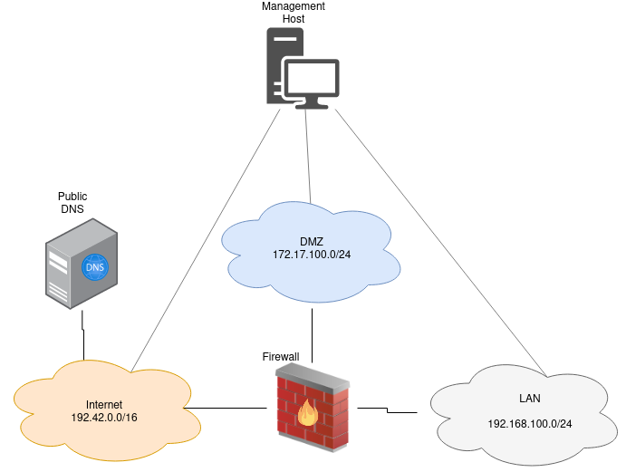

# Bootstrap

The bootstrap unit creates the shared network infrastructure **within each deployment** (router, five isolated networks, and management hosts). The [AttackBed CLI](../tools/attackbed.md) applies bootstrap first and destroys it last.

Set OpenStack/Terragrunt options in `terragrunt/terraform.tfvars` rather than editing unit HCL. The CLI uses the bootstrap configuration from the selected [scenario](../tools/attackbed.md).

