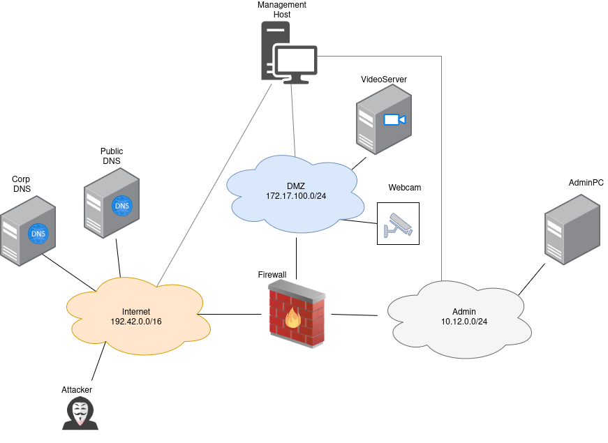

# Deploy scenarios

Select units in `config/scenarios.yaml` and deploy through the [AttackBed CLI](../tools/attackbed.md):

```sh
uv run attackbed deploy demo --copies 2
uv run attackbed destroy demo --copies 2
```

Bootstrap runs before scenario units; the order is reversed during destruction.



